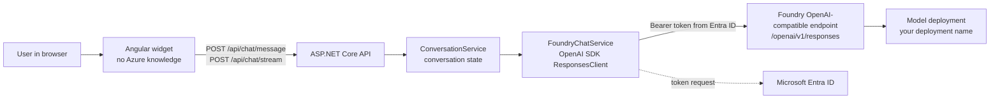
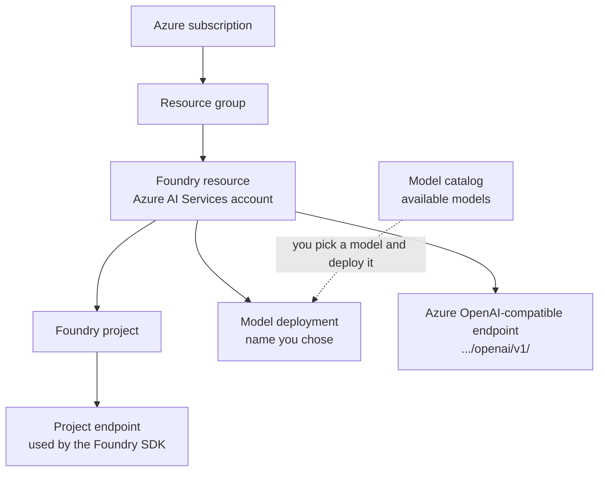
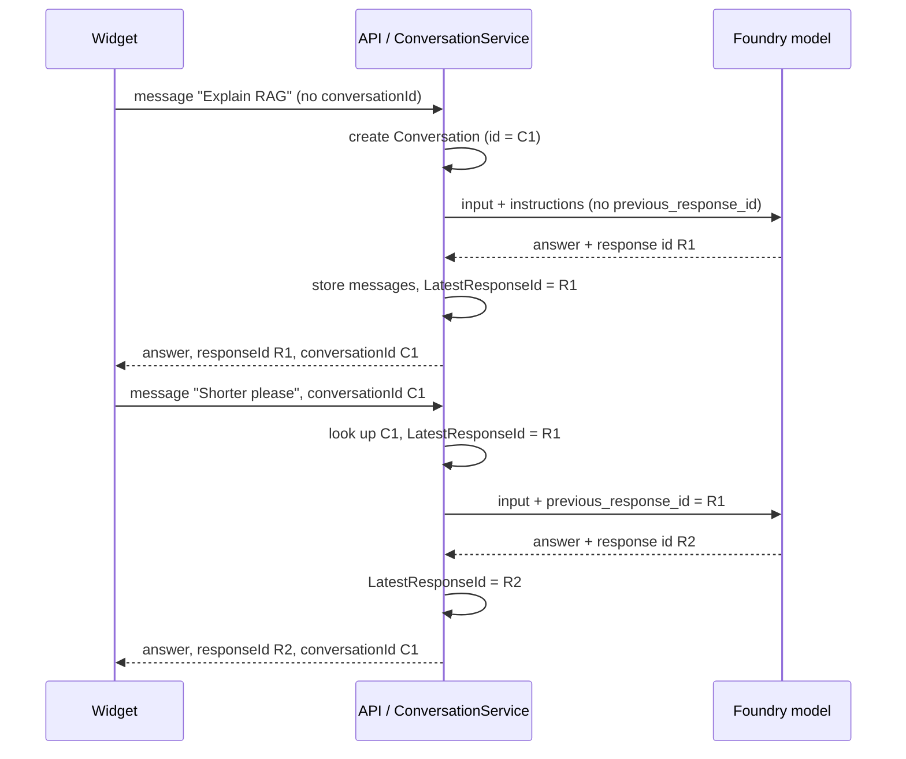

# AI-103 Study Guide: What We Built and Why

This document maps the chat application in this repository to the concepts you need for the Microsoft AI-103 certification. It describes only what is implemented in the code today. Each section covers what was built, how it works internally, how it relates to AI-103, and what to remember.

> **Verification note.** The code facts below were checked against this repository and against the OpenAI .NET SDK 2.15.0 that the project uses. The exam-relevance statements are my interpretation of the concepts. I have **not verified them against the current official AI-103 skills outline**. Before you rely on them, compare them with the "Skills measured" list on the AI-103 page on Microsoft Learn. Items marked *(not verified)* are caveats of that kind.

---

## 1. What the application does

A user types a question into a chat widget. The widget calls an ASP.NET Core API. The API calls a GPT model that you deployed in Azure AI Foundry, using the OpenAI Responses API and Microsoft Entra ID authentication. The API remembers the conversation on the server, so follow-up questions have context.



Key design point: **the frontend never touches Azure.** Only the backend holds the endpoint, the deployment name and the identity. This is the security boundary the exam expects you to understand.

---

## 2. Solution structure and why it is layered

```
AI103.ChatApp.sln
src/
  AI103.ChatApp.Domain          Conversation, ChatMessage, ChatRole (no dependencies)
  AI103.ChatApp.Application     IChatService, IConversationService, IConversationStore, DTOs, ConversationService
  AI103.ChatApp.Infrastructure  FoundryChatService, TokenCredentialFactory, options, InMemoryConversationStore
  AI103.ChatApp.Api             Controllers, Program.cs, ApiExceptionHandler
tests/
  AI103.ChatApp.UnitTests       empty scaffold (tests deferred)
web/chat-widget                 Angular widget (Shadow DOM custom element)
```

Dependencies point inward: Api and Infrastructure depend on Application, and Application depends on Domain. The Application layer defines `IChatService` and has no reference to the OpenAI SDK or Azure SDKs.

| Concern | Where it lives |
|---|---|
| HTTP, validation, status codes | Api |
| Conversation rules (chaining, history) | Application (`ConversationService`) |
| Azure/OpenAI specifics | Infrastructure (`FoundryChatService`) |
| Entities | Domain |

**AI-103 relevance.** The exam is about solutions, not only about calls. Isolating the model provider behind `IChatService` means you can swap the model, add an agent, or add retrieval without rewriting controllers.

**Remember.** The abstraction is a good practice, not an exam topic in itself. The exam topic is what sits behind it.

---

## 3. Azure AI Foundry concepts, mapped to this app

### 3.1 Resource, project, model catalog, deployment, endpoint



| Concept | What it is | Where it shows up in this app |
|---|---|---|
| **Foundry resource** | The Azure resource that hosts model deployments, endpoints, keys and RBAC. | The endpoint host in `Foundry:OpenAIEndpoint`. RBAC is assigned at this scope or above. |
| **Foundry project** | A workspace inside the resource for organising agents, files, evaluations and connections. | Not used by the OpenAI SDK path. `Foundry:ProjectEndpoint` is optional and unused. |
| **Model catalog** | The list of models you could use. A catalog entry is not callable. | Where you picked the GPT model. |
| **Model deployment** | A named, callable instance of a catalog model, with its own capacity and quota. | `Foundry:ModelDeploymentName`, sent as the `model` field. |
| **Endpoint** | The URL your code calls. | `Foundry:OpenAIEndpoint`. |

**Remember for the exam**
- You call a **deployment name**, not a model name. The name you chose when deploying is what goes in the `model` field. This is a classic mistake.
- Deployments have a type and capacity (quota). Quota exhaustion shows up as HTTP 429, which this app maps to a "busy" response.
- The catalog lists what exists. A deployment is what you can call.

### 3.2 Project endpoint vs Azure OpenAI endpoint

| | Project endpoint | OpenAI-compatible endpoint |
|---|---|---|
| Used with | Foundry SDK (`Azure.AI.Projects`) | OpenAI SDK |
| Typical purpose | Project-level features: agents, connections, evaluations | Direct model inference |
| In this app | Optional config, unused | **Used** (`Foundry:OpenAIEndpoint`) |

The Foundry SDK can also hand you an OpenAI-compatible client, so the two are not mutually exclusive. This app chose the OpenAI SDK directly because it makes the HTTP shape visible. Exact URL patterns can change, so always copy the endpoint from the portal. Never construct it by hand.

**Real mistake we hit.** The portal showed a full URL ending in `/responses`. We put it into `Foundry:OpenAIEndpoint`. The SDK appends `responses` itself, so the request went to a doubled path and the service returned HTTP 400 `invalid response_id 'responses'`. The configured base must end in `/openai/v1/`.

> Lesson: the SDK's endpoint is a **base address**, and the API route is added by the SDK.

### 3.3 OpenAI SDK vs Foundry SDK

| | OpenAI .NET SDK (used here) | Foundry SDK |
|---|---|---|
| Package | `OpenAI` | `Azure.AI.Projects` and related |
| Scope | Model inference calls | Project-level capabilities and management |
| Portability | Same code shape works against OpenAI-compatible services | Azure-specific |
| Auth in this app | `BearerTokenPolicy` + `TokenCredential` | Not used |

**Remember.** Choose by need: inference only means the OpenAI SDK is enough. Agents, project connections and evaluation point toward the Foundry SDK. *(Check the current SDK split on Microsoft Learn, because these packages evolve quickly. Not verified.)*

---

## 4. Authentication: Microsoft Entra ID, not API keys

**What we implemented.** [`TokenCredentialFactory`](../src/AI103.ChatApp.Infrastructure/Authentication/TokenCredentialFactory.cs) builds a `TokenCredential` chosen by `EntraAuth:Mode`:

| Mode | Credential | Use |
|---|---|---|
| `InteractiveBrowser` | `InteractiveBrowserCredential` with an explicit `TenantId` | Local learning. Always shows a browser sign-in and never reuses cached CLI logins. |
| `AzureCli` | `AzureCliCredential` | Local, uses `az login`. |
| `DefaultAzureCredential` | `DefaultAzureCredential` | Local chain of credentials. |
| `ManagedIdentity` | `ManagedIdentityCredential` | Azure deployment (system- or user-assigned). |

**How it works internally**
1. `BearerTokenPolicy(credential, scope)` is added to the SDK pipeline.
2. Before each request, the policy asks the credential for an access token for the configured **scope**. Tokens are cached and refreshed.
3. The policy adds `Authorization: Bearer <token>`.
4. The service validates the token's audience and the caller's **RBAC role** on the resource.

The scope used here is the Cognitive Services one, `https://cognitiveservices.azure.com/.default`. The scope must match the audience of the service you call.

**Why not an API key.** A key is a shared secret that grants access to anyone who holds it, is not tied to a person or workload, and has to be stored and rotated. Entra ID gives per-identity access, RBAC, conditional access, auditing, and no secret in code.

| | Entra ID | API key |
|---|---|---|
| Identity | Per user or workload | Anonymous holder of the key |
| Authorisation | RBAC roles, least privilege | All or nothing |
| Secrets in code or config | None | Yes |
| Rotation | Automatic short-lived tokens | Manual |
| Audit trail | Per identity | Weak |

**RBAC in our setup.** Your inherited **Foundry User** role was enough for inference. Least privilege means you grant the narrowest role that permits the calls, at the narrowest scope that works. The role needed for inference differs from the roles needed to create deployments or manage the resource.

**Local vs Azure.** The same code works in both. For deployment you set `EntraAuth:Mode` to `ManagedIdentity`, enable a managed identity on the host, and assign it the role on the Foundry resource. No code change is required. This is the pattern the exam favours.

**Remember**
- Entra ID plus RBAC is the recommended way to call Foundry models. Keys are the fallback.
- Know `DefaultAzureCredential` (a chain, convenient locally) and `ManagedIdentityCredential` (deterministic in Azure).
- A "403/401 even though I'm signed in" problem is usually a **missing role assignment or the wrong tenant**, not a code bug.
- Never put credentials in the frontend.

---

## 5. Responses API vs Chat Completions API

**What we implemented.** [`FoundryChatService`](../src/AI103.ChatApp.Infrastructure/AI/FoundryChatService.cs) calls `ResponsesClient.CreateResponseAsync` and `CreateResponseStreamingAsync`. In OpenAI .NET SDK 2.15.0 this client is `ResponsesClient`, and the Responses API is marked `[Experimental]` (diagnostic `OPENAI001`). We suppress that in the Infrastructure project only. This is an SDK maturity signal, not an Azure one.

| | Chat Completions | Responses |
|---|---|---|
| Input | Array of `messages` with roles | `input` items, optionally plus `instructions` |
| Conversation state | **You** resend the whole history every call | Service can hold state; you pass `previous_response_id` |
| Output | `choices[].message` | Typed `output` items (messages, tool calls, and so on) |
| Tools and agents | Function calling | Built for tool-using and agentic flows |
| Direction | Established, still supported | Newer, the direction of new features |

**Remember.** Responses is stateful by design. If the exam asks how to keep context without resending history, the answer is `previous_response_id` (with stored responses). Chat Completions is stateless.

---

## 6. System instructions vs user prompts

In `BuildRequest`:

```csharp
new CreateResponseOptions(deployment, [ResponseItem.CreateUserMessageItem(message)])
{
    Instructions = _options.Instructions,   // system-level behaviour
    PreviousResponseId = ...,               // chaining
    StoredOutputEnabled = _options.StoreResponses
};
```

| | Instructions | User prompt |
|---|---|---|
| Purpose | Define role, tone, rules, constraints | The actual question or task |
| Who controls it | The developer, in configuration | The end user |
| Trust level | Higher | Untrusted |
| In this app | `Foundry:Instructions` | `ChatRequest.Message` |

**Important behaviour.** With `previous_response_id`, the instructions from earlier turns are **not** automatically carried over. They apply to the request where you set them. Our code sends them on every turn, which keeps behaviour consistent. *(This is documented OpenAI behaviour as I understand it. Confirm in current docs. Not verified here.)*

**Security angle.** Instructions are not a hard security boundary. Prompt injection can try to override them. Treat user input as untrusted, validate it, and don't put secrets in instructions.

---

## 7. Response ID vs conversation ID

This is the most confusing pair, and we deliberately kept both.

| | Response ID | Conversation ID (this app) |
|---|---|---|
| Created by | The model service | **Our API** (`Guid` in `Conversation`) |
| Identifies | One model response (one turn) | The whole chat |
| Changes | Every turn | Never within a chat |
| Purpose | Sent as `previous_response_id` to chain the next turn | Lets the widget say "continue this chat" |



**Rules implemented in [`ConversationService`](../src/AI103.ChatApp.Application/Services/ConversationService.cs)**
- `conversationId` wins over `previousResponseId` if both are sent.
- An unknown `conversationId` returns HTTP 404, so the widget resets.
- Only successful turns are recorded. A failed or cancelled turn leaves the chain unchanged, so the next request chains from the last good response.
- `previousResponseId` alone is still accepted, which matches the requirement of the project brief and lets a caller continue a chain this server isn't tracking.

**Where does the context live?** Two separate things are stored:
1. **Model-side state.** The service stores the response so `previous_response_id` can reference it. This requires `StoreResponses = true`. The model uses this state to see earlier turns.
2. **Our server-side history.** `InMemoryConversationStore` keeps the messages for display and for `GET /api/chat/conversations/{id}`.

`InMemoryConversationStore` is process-local, with a 2-hour sliding and 24-hour absolute expiry. It is lost on restart and is not shared between instances. A production system would replace it with a persistent store behind the same `IConversationStore` interface.

**Remember**
- `previous_response_id` chains turns server-side, so you don't resend the history.
- Stored responses are retained by the service for a limited time. Check the current retention behaviour and data-handling terms. *(Not verified.)*
- A different model-side concept named "Conversations" also exists in the OpenAI platform. Our "conversation ID" is **our own application identifier** and is not that.

---

## 8. Synchronous vs asynchronous, streaming vs non-streaming

### Synchronous vs asynchronous (in .NET)

All model calls use `async`/`await` with `CancellationToken`. While the model thinks, the thread returns to the pool instead of blocking. This is not the same as the API's "background" or "async job" mode. In this app, "asynchronous" means non-blocking I/O.

### Non-streaming: `POST /api/chat/message`

One request returns the complete answer plus `responseId` and `conversationId`.

### Streaming: `POST /api/chat/stream`

The API returns `text/event-stream` (Server-Sent Events). The model service streams typed events, and `FoundryChatService` converts them to provider-neutral updates.

| SDK event | App behaviour |
|---|---|
| `StreamingResponseOutputTextDeltaUpdate` | Forward text chunk to the client |
| `StreamingResponseCompletedUpdate` | Record the turn, send final event with IDs |
| `StreamingResponseFailedUpdate` / `...ErrorUpdate` | Throw `ChatServiceException` |

Design details worth understanding:
- `ConversationService` accumulates the deltas and saves the turn **only on completion**.
- Once HTTP headers are sent, the status code can't change. A mid-stream failure is therefore sent as an SSE `error` event, and the widget shows it.
- The widget uses `fetch` with a stream reader, because the browser `EventSource` only supports GET and we need POST.
- C# doesn't allow `yield` inside `try/catch`, so the enumerator is advanced manually to translate exceptions.

| | Non-streaming | Streaming |
|---|---|---|
| Time to first visible text | After full generation | Within moments |
| Complexity | Low | Higher (partial failures, cancellation, proxies) |
| Best for | Short answers, back-end processing | Interactive chat |
| Total time | Similar | Similar. Perceived latency is better. |

**Remember.** Streaming improves **perceived** latency, not total generation time. Proxies and gateways that buffer responses can defeat streaming. APIM's behaviour with SSE is *not verified* here.

---

## 9. Configuration and secrets

| File | Contents | Committed? |
|---|---|---|
| `appsettings.json` | Placeholders only | Yes |
| `appsettings.Development.json` | Your real endpoint, deployment, tenant ID | **No, move before publishing** |

Options are strongly typed (`FoundryOptions`, `EntraAuthOptions`) and use `ValidateDataAnnotations().ValidateOnStart()`. If a placeholder is left in, the app fails at startup with a clear message instead of failing on the first user request. We also hit a real crash from an empty `ProjectEndpoint` and removed that property from the default config.

Endpoint URLs, deployment names and tenant IDs are **identifiers**, not secrets. They should still stay out of public repositories. Nothing in this app is a credential, because no keys exist.

**Remember.** Use the .NET configuration providers (files, environment variables, user-secrets, Key Vault), never hardcoded values. On Azure, App Service settings and Key Vault references are the usual route.

---

## 10. Error handling, logging and security hardening

### Error handling

| Situation | Where handled | Result to the client |
|---|---|---|
| Invalid body | Data annotations, `[ApiController]` | 400 ProblemDetails |
| Unknown `conversationId` | `ConversationNotFoundException` | 404 |
| Model throttled (upstream 429) | `ApiExceptionHandler` | 429 "model service is busy" |
| Other model-service failure, including auth failure | `ChatServiceException` | 502 |
| Anything else | `ApiExceptionHandler` | 500, generic message |
| Client disconnects | `OperationCanceledException` | Silently handled |

`FoundryChatService.Translate` converts `ClientResultException`, `RequestFailedException`, `AuthenticationFailedException` and `CredentialUnavailableException` into a provider-neutral `ChatServiceException`, so the API layer needn't reference Azure or OpenAI types.

### Logging

The app logs the deployment name, whether the call was chained, and response IDs. It does **not** log prompts or answers. Error details stay in server logs and are never returned to the caller.

### Security checklist (what is and is not done)

| Item | Status |
|---|---|
| No credentials in the frontend | Done |
| Entra ID only, no API keys | Done |
| Request validation (length, allowed characters in IDs) | Done |
| Cancellation support end to end | Done |
| Error messages don't leak internals | Done |
| Least-privilege RBAC | Your role assignment. Verify it. |
| Caller authentication and rate limiting | **Not done.** Planned for APIM. |
| CORS restricted to the widget origin | **Not done** |
| Prompt-injection and content safety controls | **Not done**, see section 12 |

---

## 11. Frontend independence

The Angular widget talks only to `/api/chat/*`. It knows nothing about Azure, endpoints, deployments or tokens. It is a Shadow DOM custom element, `<momo-chat-widget>`, so it can be embedded in the APIM Developer Portal as a custom widget. See [`developer-portal-widget.md`](developer-portal-widget.md) for the portal-specific details.

**AI-103 relevance.** The pattern "client → your API → model" keeps the identity and the model endpoint server-side. Calling a model directly from the browser would force you to expose a key or issue tokens to the client.

---

## 12. What this app does not cover yet (AI-103 gaps to study)

These are common AI-103-style topics that the current code does **not** implement. The list is based on typical generative-AI solution topics. Check it against the official outline. *(Not verified.)*

| Topic | Status | Why it matters |
|---|---|---|
| Retrieval-augmented generation (Azure AI Search + Blob) | Planned, not built | Grounding answers in your own data and reducing hallucination |
| Embeddings and vector search | Not built | The basis of RAG |
| Content safety and responsible AI (filters, jailbreak and prompt-injection protection) | Not configured by us | Required for production. Foundry applies default filters on deployments. Review them in the portal. |
| Evaluation of model output (groundedness, relevance) | Not built | Foundry offers evaluation tooling |
| Agents and tool/function calling | Not built | Responses API is designed for it |
| Multimodal inputs (images, audio) | Not built | Model and API support depends on the model |
| Monitoring, tracing and cost control (token usage, quota) | Basic logging only | Token usage is returned by the API but we don't record it |
| Prompt engineering and fine-tuning choices | Only a single `Instructions` string | Know when to prompt, ground (RAG) or fine-tune |
| Persistent conversation storage | In-memory only | Needed for restarts and scale-out |

---

## 13. Exam cheat sheet

**Concepts**
- Resource hosts deployments and endpoints and carries RBAC. Project organises work (agents, files, evaluations).
- Catalog is what exists. Deployment is what you call, by its own name.
- OpenAI endpoint is for inference with the OpenAI SDK. Project endpoint is for the Foundry SDK.
- Responses is stateful (`previous_response_id`). Chat Completions is stateless.
- Instructions are developer-controlled behaviour. User prompts are untrusted input.
- Response ID is per turn and from the service. Conversation ID is whatever your app defines.
- Streaming improves perceived latency. Non-streaming returns one complete result.
- Entra ID plus RBAC is preferred over keys. Managed identity is the Azure-hosted way to avoid secrets.

**Symptoms and likely causes (from our own debugging)**

| Symptom | Likely cause |
|---|---|
| HTTP 400 `invalid response_id 'responses'` | Endpoint configured with `/responses` on the end. It should be the base `/openai/v1/`. |
| HTTP 404 on the model call | Wrong deployment name. It is the deployment name, not the model name. |
| 401/403 after sign-in | Missing role assignment, wrong tenant, or wrong token scope |
| 429 | Deployment quota or rate limit reached |
| App won't start, with options validation message | A placeholder is still in configuration |
| Follow-up ignores context | `StoreResponses` is false, or `previous_response_id` isn't being sent |
| Streaming arrives all at once | A proxy or gateway is buffering the response |

**Hands-on tasks you can repeat to build confidence**
1. Change `Foundry:Instructions` and observe the new tone without code changes.
2. Set `StoreResponses` to `false` and observe that follow-ups lose context.
3. Send a follow-up with only `previousResponseId` (no `conversationId`) using Swagger.
4. Remove your role assignment and see the 401/403 path. Then restore it.
5. Compare the same prompt via `/message` and `/stream` and watch the network tab.

---

## 14. Code map

| Concept | File |
|---|---|
| Provider abstraction | `src/AI103.ChatApp.Application/Interfaces/IChatService.cs` |
| Responses API call, streaming, error translation | `src/AI103.ChatApp.Infrastructure/AI/FoundryChatService.cs` |
| Entra ID credential selection | `src/AI103.ChatApp.Infrastructure/Authentication/TokenCredentialFactory.cs` |
| Client registration, bearer-token policy | `src/AI103.ChatApp.Infrastructure/DependencyInjection.cs` |
| Strongly typed config | `src/AI103.ChatApp.Infrastructure/Configuration/` |
| Conversation and chaining rules | `src/AI103.ChatApp.Application/Services/ConversationService.cs` |
| In-memory store | `src/AI103.ChatApp.Infrastructure/Conversations/InMemoryConversationStore.cs` |
| Endpoints, SSE (Swagger UI is enabled in the Development environment only) | `src/AI103.ChatApp.Api/Controllers/ChatController.cs` |
| Error mapping | `src/AI103.ChatApp.Api/ApiExceptionHandler.cs` |
| Widget | `web/chat-widget/src/app/` |
| Portal deployment notes | `docs/developer-portal-widget.md` |

---

## 15. Validation status

- The solution builds with 0 warnings and 0 errors.
- The conversation logic was checked against a fake model in a throwaway console project (since deleted). Those checks covered chaining, `conversationId` precedence, history, 404 handling, failed turns not recorded, stream assembly and cancellation.
- Calls to the real model succeeded earlier in the project (Phase 9). The re-test through the final conversation path, and the browser UI, have **not** been run by me.
- There are no automated unit tests in the repository at present.
